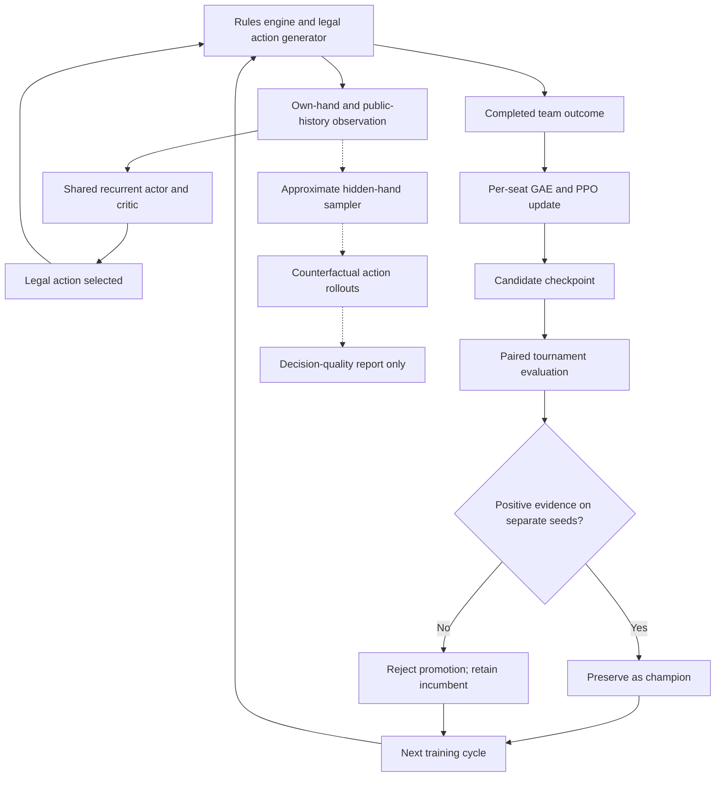

# Daguai: Continuous Self-Play Reinforcement Learning and Counterfactual Decision Auditing for a Six-Player Cooperative Card Game

**A systems and methods report — working manuscript, not peer reviewed**

**Version:** 1.0 · **Date:** November 2026 · **Authors:** Daguai Web project contributors

**Code:** [nnamuhcs/daguai](https://github.com/nnamuhcs/daguai)

> **Research status.** This paper describes an implemented game environment, neural training pipeline, evaluation controller, and diagnostic counterfactual evaluator. It does **not** claim superhuman play, expert-human strength, or statistically established improvement from the newest PPO model. Historical v1/v2 scores come from the project's handoff records; they are not newly reproduced experiments. Bounded counterfactual search currently **audits** decisions and is **not used to calculate PPO rewards or train the policy**.

## Abstract

Learning effective policies in cooperative, imperfect-information card games requires more than recognizing legal card combinations. Agents must preserve their own private information, infer hidden holdings, anticipate delayed consequences, and coordinate with teammates whose hands and intentions are only partially observed. We describe **Daguai**, an experimental reinforcement-learning system for a six-player, three-versus-three implementation of Shanghai 大怪路子. Its architecture combines a rules-verified game engine, seat-relative observations and public-history recurrence, a shared action-conditioned actor and state-value critic trained with proximal policy optimization (PPO), and a continuous evaluation controller that can reject weaker checkpoints. An experimental strategic representation augments the baseline network with hand-decomposition features, actor-known transfer memory, and residual encoders. A separate counterfactual decision audit samples hidden-card worlds consistent with available information, replays alternative legal actions under a fixed heuristic continuation, and estimates paired differences and decision regret. We formalize the objectives, advantage estimation, PPO updates, belief-conditioned rollouts, and promotion tests, and identify the limitations of these approximations. Historical benchmarks demonstrate the central challenge: a later Monte Carlo checkpoint performed worse than an earlier one under a particular validation protocol, so additional training cannot be equated with improving play. The contribution of the current system is a **measurable experimental framework**, not a claim of solved strategy.

**Keywords:** multi-agent reinforcement learning; imperfect-information games; self-play; cooperative card games; PPO; credit assignment; belief sampling; counterfactual evaluation; continuous learning.

**Play locally:** With Node.js 24 or newer, run `npm start` from a clone of the
repository and open [localhost:3000](http://localhost:3000). The default rule
bot needs no model weights. See the [training runbook](CONTINUOUS_LEARNING.md),
[implementation status](IMPLEMENTATION_STATUS.md), and
[decision audit guide](COUNTERFACTUAL_DECISION_AUDIT.md) for setup and diagnostics.

<details>
<summary><strong>Contents</strong></summary>

1. [Introduction](#1-introduction)
2. [Game and learning problem](#2-game-and-learning-problem)
3. [System overview](#3-system-overview)
4. [Representation and neural policy](#4-representation-and-neural-policy)
5. [Team rewards and temporal credit assignment](#5-team-rewards-and-temporal-credit-assignment)
6. [PPO optimization](#6-ppo-optimization)
7. [Belief-conditioned counterfactual decision audit](#7-belief-conditioned-counterfactual-decision-audit)
8. [Continuous learning and champion selection](#8-continuous-learning-without-silently-shipping-regressions)
9. [Evaluation design](#9-evaluation-design)
10. [Evidence currently available](#10-evidence-currently-available)
11. [Failure modes and limitations](#11-failure-modes-and-limitations)
12. [Proposed experiments](#12-proposed-next-experiments-not-claims-of-completed-work)
13. [Reproducibility](#13-reproducibility-and-source-map)
14. [Conclusion](#14-discussion-and-conclusion)

</details>

---

## 1. Introduction

In a multiplayer shedding game, a move that discards many cards need not be a good move. Spending a valuable Joker can win an unimportant trick; passing can preserve the only future recapture; overtaking a teammate can prevent a coordinated finish. A strategy must evaluate how a choice affects the **team's eventual outcome**, often many turns later.

This creates three related problems:

1. **Partial observability:** the acting player sees its hand and public events, not the other five hands.
2. **Multi-agent credit assignment:** a winning team's actions are not all good, and a losing team's actions are not all bad.
3. **Reliable improvement measurement:** loss curves, optimizer updates, and game counters do not establish that later checkpoints make better decisions.

Daguai addresses these with an operational separation between **learning**, **decision analysis**, and **independent evaluation**. The neural policy learns from on-policy gameplay and terminal team results. An offline counterfactual audit probes alternative first moves under plausible hidden deals. A controller promotes candidate checkpoints only after paired, separate-seed tournament comparisons.

### Contributions and scope

- An imperfect-information six-player rules engine with legal-action generation and checks for card conservation, turn order, tribute/return, and asking.
- A shared recurrent actor–critic trained with team-reward PPO, per-player decision trajectories, and potential-based shaping.
- An experimental v3 representation of hand structure and actor-known private transfers, initialized so residual branches do not immediately alter the transferred v2 scores.
- A bounded, **diagnostic-only** counterfactual evaluator that compares legal alternatives on matched hidden-world samples.
- A continuous experiment controller that records candidates, independently tests promising checkpoints, and preserves a stronger incumbent rather than automatically serving the newest weights.
- A clear protocol for distinguishing **parameters changed**, **decisions changed**, and **playing strength improved**.

This is a **system description and research plan**, not a completed study demonstrating expert performance.

## 2. Game and learning problem

### 2.1 Game configuration

The evaluated implementation uses six players in alternating teams, **three standard decks (162 physical cards including Jokers)**, and **27 cards per player** at the initial deal. The teams are seats $\{0,2,4\}$ and $\{1,3,5\}$; play proceeds counterclockwise and skips players who have finished. Legal plays contain **1, 2, 3, or 5 cards**. The five-card comparison hierarchy includes five of a kind, straight flush, four-plus-one, full house, flush, and straight. A round also has an active level/trump rank and Joker semantics. The environment supports public action history, asking, tribute and return, and continued rounds. Specific conventions follow this repository's implemented rules, not a claim about every regional variant.

A round ends when one team has all three members out. The current implementation's winner/draw logic also depends on the team of the **head finisher**. Full details and regression fixtures are in [`engine.js`](engine.js) and [`engine.test.js`](engine.test.js).

### 2.2 Information sets

Let $s_t$ be the **complete simulator state**, including all six private hands. Let $I_t^i$ be the information legitimately available to player $i$ at decision time $t$:

$$
I_t^i = \big(H_t^i,\ P_t,\ E_{\le t},\ M_t^i\big),
$$

where $H_t^i$ is the player's own hand, $P_t$ is public game state, $E_{\le t}$ is observed public play/pass/ask history, and $M_t^i$ denotes private information known to that player (for example, a card it personally sent or received through a transfer).

The legal-action set is generated by the rules engine:

$$
\mathcal A(I_t^i)=\{a: a\text{ is legal in the player's observed decision state}\}.
$$

The actor receives $I_t^i$ and action features. It does **not** receive $s_t$ or the true unplayed cards of other players. The simulator must of course hold the actual hands to advance the game; this does not authorize passing them into policy inputs.

### 2.3 Objective

The implemented **round-level** team return is

$$
R_i =
\begin{cases}
+1,&\text{player }i\text{'s team wins},\\
0,&\text{round is drawn},\\
-1,&\text{player }i\text{'s team loses}.
\end{cases}
$$

All members of the same team receive that team's terminal outcome. The strategic target is the observable-information policy

$$
\pi^* \in \arg\max_{\pi}\;\mathbb E_{\pi,\pi_{-i}}[R_i],
$$

with expectations taken over hidden deals, teammate/opponent behavior, and stochastic play. More explicitly, for a particular decision, the desirable action maximizes its **expected team return**, not the immediate number of cards discarded:

$$
a^*(I)=\arg\max_{a\in\mathcal A(I)}\mathbb E[R_{\mathrm{team}}\mid I,\operatorname{do}(a),\text{future policies}].
$$

The result depends on the continuation policies and hidden-state distribution. The implementation does not compute this optimum exactly. Its round reward also does **not yet formally optimize full multi-round level progression**; that would require an explicit match-level objective and a separate evaluation protocol.

## 3. System overview



**Solid arrows** indicate the implemented training/evaluation loop; **dashed arrows** indicate the separate diagnostic audit. The audit does not feed rewards back into PPO.

Primary modules are [`training/team_ppo.py`](training/team_ppo.py), [`training/continuous_learn.py`](training/continuous_learn.py), [`training/tournament.py`](training/tournament.py), [`strategic-beliefs.js`](strategic-beliefs.js), [`training/counterfactual-env.js`](training/counterfactual-env.js), and [`training/decision_quality.py`](training/decision_quality.py).

## 4. Representation and neural policy

### 4.1 Baseline recurrent architecture (v2)

The baseline uses an **observation vector of length 922**, an **action vector of length 81**, and **public event vectors of length 71**. The observation encoder outputs 256 features, and a GRU processes the acting seat's public-history view into 128 features. These are concatenated into a 384-dimensional context:

$$
h_t^i=\operatorname{GRU}(e_{\le t}^{i}),\qquad
c_t^i=\big[\operatorname{Enc}(o_t^i)_{256};\;h_t^i{}_{128}\big].
$$

The v2 policy network has **465,793 parameters** in its encoder/GRU/action head. The actor MLP is $465\!\rightarrow\!256\!\rightarrow\!128\!\rightarrow\!1$, where $465=384+81$. Adding the independent $384\!\rightarrow\!128\!\rightarrow\!1$ value head gives a **515,202-parameter** baseline PPO actor–critic. An action-conditioned head assigns a scalar **logit** to each *legal* action; a separate head estimates the return of the position:

$$
z_\theta(I_t^i,a)=f_\theta\big([c_t^i;\,x(a)]\big),\qquad
V_\phi(I_t^i)=g_\phi(c_t^i).
$$

The value head is independent of the selected action. The actor and critic use only the acting player's observation and publicly visible history. They can share parameters without sharing private hands among players.

The network converts the action logits to a categorical policy using temperature $T>0$:

$$
\pi_\theta(a\mid I)=
\frac{\exp(z_\theta(I,a)/T)}
{\sum_{b\in\mathcal A(I)}\exp(z_\theta(I,b)/T)}.
$$

With lower $T$, sampling is more concentrated; with higher $T$, it explores more legal choices. A greedy policy takes $\arg\max_a z_\theta(I,a)$. The original PPO warm start preserves transferred **scores/rankings**, but preserving rankings alone does not guarantee preservation of the previous exploration distribution. A separate distillation/preparation path exists to address this.

### 4.2 Experimental strategic representation (v3)

The current v3 manifest specifies **1,054 observation features**, **105 action features**, and the same **71-element public event encoding**. The extra observation channels include bounded hand-structure features and **actor-known** transfer-memory fields. Action features include cards removed, Jokers/trumps consumed or left, remaining-hand partition indicators, and context about teammates and opponents.

The experimental actor–critic uses a card-set encoder and a private-transfer encoder in addition to the inherited v2 representation. Its outputs have the residual form

$$
z_{\mathrm{v3}}(I,a)=z_{\mathrm{v2}}(I,a)+\Delta z_{\mathrm{strategic}}(I,a),
\qquad
V_{\mathrm{v3}}(I)=V_{\mathrm{v2}}(I)+\Delta V_{\mathrm{strategic}}(I).
$$

The residual branches' final layers are initialized to zero, preserving initial transferred outputs before subsequent learning updates. This **initialization property** is not a claim that v3 is already a stronger player.

Hand features provide constructive information about legal partitions. For sufficiently small hands, a bounded solver computes an exact minimum number of uninterrupted lead plays; larger hands use a constructive upper bound rather than a fabricated exact estimate. These features describe **observable structure**, not a heuristic's prescribed move.

See [`training/manifests/strategic-v3.json`](training/manifests/strategic-v3.json), [`strategic-policy.js`](strategic-policy.js), and [`training/team_ppo.py`](training/team_ppo.py).

## 5. Team rewards and temporal credit assignment

### 5.1 Why terminal outcomes are not move labels

Suppose the team wins after 30 decisions. Assigning $+1$ as the *quality label* for every one of those decisions would be wrong: some choices might have harmed the team and been rescued by teammates. Conversely, a good defensive move may appear in a lost round.

The reinforcement-learning task is therefore to estimate whether a chosen action's later outcome was **better or worse than the policy's expected outcome in that information state**. This is statistical credit assignment, not direct observation of the causal quality of every move.

### 5.2 Potential-based shaping

Daguai uses a public team-finishing potential in the seat-relative observation:

$$
\Phi_i(I)=\eta\,\frac{F_{\mathrm{ally}}(I)-F_{\mathrm{opponent}}(I)}{3},
\qquad \eta=0.3\ \text{by default}.
$$

The shaped reward between consecutive **decision states of the same player** is

$$
r'_{i,k}=r_{i,k}+\gamma\Phi_i(I_{i,k+1})-\Phi_i(I_{i,k}),
$$

with the terminal potential set to zero. The implementation **requires $\gamma=1$**. Along a complete per-player decision trajectory, potential terms telescope:

$$
\sum_{k=0}^{K_i-1}r'_{i,k}
=R_i-\Phi_i(I_{i,0})
\quad \text{when}\quad\Phi_i(I_{i,K_i})=0.
$$

This identity is conditional on correctly accounting for transitions between the player's decisions, including intervening teammate/opponent actions and early finishers. Potential-based shaping can preserve the target objective under the appropriate assumptions [3]; it does **not** certify that the reward attributed to a particular move is causally correct. The shaped critic estimates a **shaped return**, not a calibrated probability of winning.

Daguai deliberately does **not** issue independent rewards for shedding cards, playing Jokers, overtaking teammates, or finishing personally. Such bonuses could conflict with team success.

### 5.3 Per-player generalized advantage estimation

For each acting seat $i$, let $k$ enumerate **that seat's own consecutive decisions**, even when other players move between them. With $V_{i,k}=V_\phi(I_{i,k})$, the temporal-difference error is

$$
\delta_{i,k}=r'_{i,k}+V_{i,k+1}-V_{i,k},
\qquad V_{i,K_i}=0.
$$

Generalized advantage estimation (GAE) [2] recursively computes

$$
\hat A_{i,k}=\delta_{i,k}+\lambda\hat A_{i,k+1},
\qquad \lambda=0.95\ \text{by default},
$$

and the value target is

$$
\hat G_{i,k}=V_{i,k}^{\mathrm{old}}+\hat A_{i,k}.
$$

The terminal team reward is assigned on each learner's final recorded decision, including players who finished before the round ended. Opposing teams receive opposite terminal signs where applicable.

**Illustration, not a measured Daguai decision:** if the value before a decision is $-0.25$, the next same-player value is $+0.10$, and the transition shaping reward is zero, then $\delta=+0.35$. Later TD errors can increase or decrease the final GAE advantage. A positive advantage means **better than predicted**, not **proved optimal**.

## 6. PPO optimization

PPO [1] updates the actor using data collected under a fixed behavior policy $\pi_{\mathrm{old}}$. Define the probability ratio

$$
\rho_t(\theta)=\frac{\pi_\theta(a_t\mid I_t)}{\pi_{\mathrm{old}}(a_t\mid I_t)}.
$$

The clipped surrogate objective is

$$
L^{\mathrm{CLIP}}(\theta)=
\mathbb E_t\!\left[
\min\!\left(\rho_t\hat A_t,
\operatorname{clip}(\rho_t,1-\epsilon,1+\epsilon)\hat A_t\right)
\right],\quad\epsilon=0.2.
$$

The code minimizes its negative, along with a clipped value loss and entropy regularization. With $V_t^{\mathrm{old}}$ saved at rollout time, define

$$
V_t^{\mathrm{clip}}=V_t^{\mathrm{old}}+
\operatorname{clip}(V_\phi(I_t)-V_t^{\mathrm{old}},-\epsilon,+\epsilon),
$$

$$
L_V=\frac12\mathbb E_t\!\left[
\max\!\left((V_\phi(I_t)-\hat G_t)^2,
(V_t^{\mathrm{clip}}-\hat G_t)^2\right)
\right],
$$

$$
\boxed{\ \mathcal L=-L^{\mathrm{CLIP}}+0.5L_V-\beta\mathbb E_t[H(\pi_\theta(\cdot\mid I_t))]\ },
\qquad \beta=0.01\ \text{by default}.
$$

The loss is differentiated through the actor/critic network and optimized using Adam. The clipped objective limits the **surrogate change**, not a hard bound on policy divergence. Accordingly, Daguai measures a full-batch approximate KL after each optimization epoch:

$$
\widehat D_{\mathrm{KL}}^{(k3)}
=\frac1N\sum_t\big[\rho_t-1-\log\rho_t\big],
$$

and stops further epochs on that rollout if it exceeds the configured target.

### 6.1 Reference PPO configuration from source

| Quantity | Current default |
|:--|--:|
| Concurrent simulator workers | 4 |
| Completed games per rollout | 8 |
| PPO epochs per rollout | 4 |
| Minibatch size | 64 |
| Learning rate | $10^{-4}$ |
| $\gamma$ | 1.0 (enforced) |
| GAE $\lambda$ | 0.95 |
| PPO clipping $\epsilon$ | 0.2 |
| Entropy coefficient | 0.01 |
| Policy sampling temperature | 0.2 |
| Team-finish potential scale | 0.3 |
| Target approximate KL | 0.015 |
| Gradient-norm clipping | 5.0 |

These are configuration defaults, **not experimentally established optimal hyperparameters**. PPO batches include current self-play, frozen historical policies, and rule opponents, with a configured probability of mixing a rule-based teammate. The current-policy weights remain fixed during rollout collection; only transitions controlled by the current learner should enter its PPO loss. Complete batches are reused across the configured PPO epochs, not as an unbounded off-policy replay buffer.

### 6.2 Pseudocode of one learning cycle

```text
initialize or resume actor/critic and optimizer
repeat for each training cycle:
    freeze behavior parameters theta_old
    collect complete games with current, historical, and heuristic seats
    retain only decisions made by the current learner
    for each episode and each acting seat:
        attach terminal TEAM outcome at that seat's final decision
        calculate potential differences between same-seat decisions
        compute GAE advantages and value targets
    normalize advantages once across the collected batch
    for each PPO epoch:
        shuffle decisions and update actor/critic on minibatches
        recompute full-batch approximate KL
        break if KL exceeds target
    save frozen candidate and optimizer/RNG lineage
    evaluate candidate and incumbent on matched seeded deals
    if separate confirmation tests pass:
        preserve candidate as a new champion
    otherwise:
        keep incumbent; continue the training lineage
```

A training run may continue while the best deployment-eligible champion remains unchanged. **Continuous training is not monotonic improvement**.

## 7. Belief-conditioned counterfactual decision audit

PPO estimates advantage from actions actually selected. An independent decision audit can ask: **What if the player had chosen another legal move at the same decision point?**

### 7.1 Possible hidden worlds

Given information set $I$, define a distribution over other players' hidden hands:

$$
\hat p(b\mid I),\qquad b\in\mathcal B(I).
$$

Here $\mathcal B(I)$ contains physical-card assignments consistent with the acting player's own hand, observed played cards, public card counts, and supported information from asking and transfer events. The implemented sampler shuffles the **remaining deck cards**, allocates them to unknown hands by public hand capacities, and rejects assignments violating encoded evidence. Passes are **not** treated as proof that a player was unable to beat a trick.

This is an **approximate, constraint-conditioned sampler**, not a calibrated learned posterior. Rejection can be inefficient or biased, especially with intricate private-transfer constraints. The code refuses to invent worlds when too few valid samples are produced.

A crucial privacy invariant is that substituting different actual hidden hands in the simulator, while holding the acting player's legitimate information fixed, must not change the counterfactual estimates for a fixed audit seed. The sampler's instantiated worlds are used only inside the copied simulation.

### 7.2 Paired rollouts

Let $a$ be a candidate legal first action and $b_k$ the $k$-th sampled hidden world. Apply $a$ to a copy of that world and complete the round with the **engine heuristic controlling all subsequent seats**. The observed terminal score is

$$
S(a,b_k)=
\begin{cases}
1,&\text{team wins},\\
0.5,&\text{draw},\\
0,&\text{team loses}.
\end{cases}
$$

The audit's score is a rescaling of the terminal PPO reward, $R=2S-1$, for the same win/draw/loss outcomes. The estimated action score is

$$
\widehat Q_{\mathrm{audit}}(I,a)=\frac1K\sum_{k=1}^{K}S(a,b_k).
$$

Every candidate is tested against the **same sampled worlds**. For action $a$ versus a reference choice $a_0$, the paired difference is

$$
d_k=S(a,b_k)-S(a_0,b_k),\qquad
\bar d=\frac1K\sum_k d_k,
$$

with estimated standard error and an approximate normal interval

$$
\widehat{\mathrm{SE}}(\bar d)=\frac{s_d}{\sqrt K},\qquad
\mathrm{CI}_{95\%,\mathrm{approx}}=\bar d\pm1.96\,\widehat{\mathrm{SE}}(\bar d).
$$

The implementation bounds the candidate count, world count, and total simulated rollouts. It generally audits the policy's top-ranked actions plus a legal pass (when available), not the exhaustive legal set. At least four valid worlds are required; typical command defaults are **12 positions, 8 worlds per position, and top 4 actions**.

**Do not interpret this interval as a proof of causal action quality.** It omits uncertainty about the belief sampler and continuation policy. Reusing matched worlds helps comparisons, but selecting the maximum over several noisy candidates creates optimistic selection bias.

### 7.3 Estimated regret and old-versus-new comparisons

For evaluated candidate set $\mathcal C(I)\subseteq\mathcal A(I)$, define

$$
\widehat{\mathcal R}(I;a_{\mathrm{chosen}})=
\max_{a\in\mathcal C(I)}\widehat Q_{\mathrm{audit}}(I,a)
-\widehat Q_{\mathrm{audit}}(I,a_{\mathrm{chosen}}).
$$

For two frozen policies evaluated on the **same position and worlds**,

$$
\Delta_{\mathrm{decision}}(I)=
\widehat Q_{\mathrm{audit}}(I,a_{\mathrm{new}})
-\widehat Q_{\mathrm{audit}}(I,a_{\mathrm{old}}).
$$

These quantities make behavior change observable: they can highlight when a new model passes instead of overtaking a teammate, preserves a Joker, or accepts a useful pair. The audit does **not** know whether the heuristic continuation reflects an expert's future decisions. Thus lower estimated regret is a **diagnostic hypothesis**, not sufficient evidence of stronger gameplay.

### 7.4 Why these estimates do not yet train PPO

A fixed heuristic continuation may systematically undervalue long-horizon cooperation or overvalue immediate control. Feeding its biased scores back into the policy would risk teaching the network the heuristic's mistakes. In the current code the audit is **read-only**: it produces reports and does **not** change $R_i$, GAE, PPO gradients, or champion promotion.

A future **experimental** auxiliary action-value loss could be

$$
L_Q(\psi)=\frac1M\sum_{j=1}^{M}
\big(Q_\psi(I_j,a_j)-\widehat Q_{\mathrm{audit}}(I_j,a_j)\big)^2.
$$

A search-policy target could alternatively use $\operatorname{softmax}(\widehat Q/\tau)$ followed by a KL distillation loss. **Neither is implemented as an active training objective.** Both should be considered only after calibrated search targets and an ablation against an otherwise identical PPO baseline demonstrate better independent tournament performance.

## 8. Continuous learning without silently shipping regressions

The continuous controller distinguishes the **latest training checkpoint** from the **current champion**. After each bounded training cycle, it freezes a candidate and records its provenance and checkpoint hash. The candidate and incumbent each play the original heuristic in **3-vs-3** matches on identical seeded deals, with the sides swapped. This compares their results against the same opponent; it is not a direct candidate–incumbent match.

The outcome score over $N$ games is

$$
\operatorname{Score}=\frac{W+\tfrac12D}{N},
$$

where $W$ and $D$ are wins and draws. This is **not the raw win rate**. Opposite-side paired deals support bootstrap confidence intervals for score differences.

For incumbent $C$ and candidate $N$, the model comparison is

$$
\Delta=\operatorname{Score}(N)-\operatorname{Score}(C).
$$

Promising candidates face a **second test on disjoint confirmation deals**. Promotion requires the lower bound of the paired confirmation interval to exceed the configured minimum gain. A champion is preserved separately from the mutable training lineage; browser inference is **not automatically reloaded or promoted**. Historical mixed-team results below are not part of this gate.

The controller also tracks an exploratory *research-best* neural checkpoint. Because this can be selected by noisy validation point estimates, **research-best is not a certificate of improvement**.

### 8.1 Three distinct meanings of “learning”

| Claim | Measurement | What it establishes |
|:--|:--|:--|
| Parameters changed | Tensor-wise comparison of checkpoint weights and optimizer updates | An update actually happened |
| Behavior changed | Different selected legal actions on matched information states | The policy is different |
| Playing strength improved | Positive paired outcome difference, confirmed on unused deals | Evidence the new policy is stronger against the tested opponent distribution |

No one row implies the row beneath it. In particular, running additional self-play games, reducing training loss, or increasing the model's entropy statistics does not demonstrate stronger card play.

## 9. Evaluation design

### 9.1 Tournament endpoints

In addition to wins/losses/draws and the score above, the current tournament tool records the four terminal categories (`WIN`, `LOSS`, `DRAW_WE_COMPLETED`, and `DRAW_THEY_COMPLETED`). These distinguish the team that completed from the team that owned the head finisher. It also measures head-finisher rate, team-completion rate, mean finishing position, cards left, Jokers used, teammate overrides, feed receptions leaving legal remainders, tricks held, and return decisions.

The principal comparisons should include (i) candidate versus heuristic, (ii) candidate versus earlier frozen neural checkpoints, and (iii) fresh versus continued rounds, all in full 3-vs-3 teams. Human games, if later available through an authorized interface, would provide an essential independent generalization test.

### 9.2 Control of evaluation bias

- Use frozen checkpoint files, hashes, a rules/protocol fingerprint, and identical seeded deals with candidate sides swapped.
- Separate exploratory validation, checkpoint-confirmation, and sealed final-test seed families.
- Report the paired confidence interval **and** the raw win, loss, and draw counts.
- Do not repeatedly tune to the final test set; doing so converts it into a validation set.
- Keep historical mixed-team results separate from the current full-team benchmarks.
- Test continued tribute/return rounds explicitly; fresh-deal performance alone is incomplete.
- Assess matchup robustness across independent opponent styles, not only the heuristic present in the training mix.

## 10. Evidence currently available

### 10.1 Historical evaluation from the project handoff

The following are **historical 200-game, heuristic-opponent assessments**, not new measurements from this manuscript. Score is $(W+0.5D)/200$.

| Frozen policy and team composition | Wins | Losses | Draws | Score |
|:--|--:|--:|--:|--:|
| v1 (80-game checkpoint), three neural seats | 5 | 147 | 48 | 0.1450 |
| v2 (1,000 games), three neural seats | 3 | 151 | 46 | 0.1300 |
| v2 (1,000 games), one neural seat | 33 | 82 | 85 | 0.3775 |
| v2 (8,000 games), three neural seats | 2 | 171 | 27 | 0.0775 |
| v2 (8,000 games), one neural seat | 35 | 105 | 60 | 0.3250 |

In the historical fixed-seed paired protocol, the v2 **three-neural-seat** score fell by **0.0525** between 1,000 and 8,000 games. The handoff reported a paired 95% confidence interval of **[−0.0900, −0.0150]** for this difference. This is evidence of deterioration under that particular exploratory protocol, **not** a complete learning curve, proof of universal regression, or an independent final-test result. Reuse of validation seeds and checkpoint selection limits stronger inference.

### 10.2 What source-level verification does and does not show

The archived handoff records a **40-game PPO verification branch**, **468 optimizer steps**, and successful CUDA training/resume tests on the development RTX 5090. The later source archive includes v3 strategic features, an on-policy PPO trainer, a continuous controller, and a counterfactual decision audit. Its implementation-status notes record a **58-test JavaScript suite** and targeted CPU smoke checks, including one 8-game train/evaluate cycle. Those are **reported development checks**; they are not an independent replication of complete strength results in this manuscript.

In the local continuous run, Cycle 5 scored **52.65%** versus the heuristic's **50.00%** baseline on its 1,000-game fresh-round confirmation, a paired gain of **2.65 percentage points** (95% interval: **+0.4 to +4.8 points**). That cleared the training promotion gate for that checkpoint. It did not establish superiority on the sealed final split, in continued rounds, against expert humans, or for later checkpoints. Model weights and local evaluation data are not included in this repository.

## 11. Failure modes and limitations

1. **Noisy, delayed credit:** GAE is an estimator, not counterfactual proof of why a team won. Early critic predictions can be inaccurate.
2. **Distributional drift:** self-play agents and opponents change, so a policy can become specialized to a weak historical league.
3. **Transfer temperature:** preserving v2 greedy rankings does not imply that categorical PPO sampling preserves the v2 behavior distribution.
4. **Imperfect beliefs:** uniform shuffle with evidence-based rejection is not an automatically calibrated posterior over hidden cards. Actual opponent hands must remain excluded from live policy inputs.
5. **Determinization artifacts:** the heuristic rollout sees a fully instantiated game state, which can produce strategy-fusion or information-use artifacts. It is not an information-set equilibrium solver.
6. **Biased action selection:** the maximum of several noisy action-value estimates makes estimated regret optimistic; the bounded top-$k$ set can miss the genuinely best legal action.
7. **Small-search uncertainty:** a handful of matched worlds cannot resolve many close strategic decisions, and the approximate interval conditions on a questionable sampler.
8. **Tournament generalization:** performance against one heuristic and fresh deals alone cannot establish high-level team intelligence.
9. **Round-versus-match objective:** terminal reward presently reflects round success, while real competitive success may depend on dealer, level, and continued-round consequences.
10. **Engineering versus achievement:** successful tests, checkpoint saves, and PPO optimizer steps verify code paths—not intelligent cooperation or human-expert strength.

## 12. Proposed next experiments (not claims of completed work)

| Experiment | Question answered | Decision criterion |
|:--|:--|:--|
| Warm-start entropy and rank audit | Is PPO's actual sampled policy similar to its v2 source? | Measure top-action probability and behavior KL on held-out states |
| Retrospective v2 learning curve | Did v2 degrade smoothly or were the two observed checkpoints atypical? | Evaluate intermediate frozen milestones on separate deals |
| Strategic v3 ablation | Do hand structure and private memory improve play? | Independent paired gain vs identical-budget v2 run |
| Belief calibration | Does sampled hidden-card uncertainty match actual frequencies? | Calibrated prediction errors by seat, card type, and game phase |
| Search-vs-no-search audit | Do heuristic continuations rank good moves reliably? | Correlation with held-out outcomes; error analysis on cooperation cases |
| Auxiliary Q-target trial | Does simulated action-value supervision help PPO? | A/B train with matched compute and data; final held-out score gain |
| Multi-opponent league | Does the policy generalize to other playing styles? | No substantial loss against independent frozen opponents |
| Continued-round evaluation | Does tribute/return behavior improve? | Separate paired results on genuine continued-round fixtures |
| Expert-human evaluation | Is the agent competitive with skilled teams? | Pre-registered matches with role/seat rotation and sufficient sample size |

The priority is **valid training evidence** before expensive search or large-scale training. Improved throughput can increase the experimental budget, but larger budgets alone do not guarantee learning.

## 13. Reproducibility and source map

### Source modules

| Component | Repository path |
|:--|:--|
| Game rules and legal choices | [`engine.js`](engine.js) |
| Baseline public/private encodings | [`policy.js`](policy.js), [`foundation-policy.js`](foundation-policy.js) |
| PPO, GAE, critic, metrics | [`training/team_ppo.py`](training/team_ppo.py) |
| Strategic v3 features and manifest | [`strategic-policy.js`](strategic-policy.js), [`training/manifests/strategic-v3.json`](training/manifests/strategic-v3.json) |
| Belief sample and summaries | [`strategic-beliefs.js`](strategic-beliefs.js) |
| Counterfactual simulator | [`training/counterfactual-env.js`](training/counterfactual-env.js) |
| Decision-quality reports | [`training/decision_quality.py`](training/decision_quality.py) |
| Paired tournaments | [`training/tournament.py`](training/tournament.py) |
| Continuous selection and checkpointing | [`training/continuous_learn.py`](training/continuous_learn.py) |
| Tensor/behavior evidence | [`training/learning_evidence.py`](training/learning_evidence.py) |
| Testing and integration | [`training/test_team_ppo.py`](training/test_team_ppo.py), [`training/test_decision_quality.py`](training/test_decision_quality.py) |

### Reproduction commands

Run from the repository root, with dependencies installed as described in the project's setup documentation. **These commands do not create proof of strength by themselves.**

```bash
# Rules / JavaScript tests
npm test

# PPO Python tests
npm run audit:ppo

# Continuous-learning run status
npm run learn:status

# Paired tournament; supply a real, frozen local checkpoint path
npm run eval:tournament -- \
  --checkpoint /path/to/frozen-model.pt \
  --opponent heuristic \
  --games 400 --model-seats 3 --split debug \
  --seed 20500000 --report /tmp/daguai_tournament.json

# Counterfactual decision audit (diagnostic; no training reward)
npm run learn:decisions -- \
  --checkpoint /path/to/new-model.pt \
  --compare-old /path/to/old-model.pt \
  --positions 24 --worlds 8 --top-k 4 \
  --output /tmp/daguai_decisions.json
```

**Publication checklist.** Before publishing quantitative results, archive exact checkpoint hashes, full config, rules/protocol fingerprint, evaluation seeds, W/L/D and paired CI, hardware/software versions, and the relevant result JSON files. Remove private data or credentials. Supply the project license and author list separately; neither is inferred by this paper.

## 14. Discussion and conclusion

Daguai's central design principle is that **a good move is one that improves the team's expected outcome given the information available to the acting player**. The implementation divides the task into complementary roles. The rules engine defines valid actions and terminal results; the recurrent actor–critic learns from team outcomes; GAE estimates relative action advantages; PPO updates policy weights; counterfactual rollouts probe alternative decisions under sampled hidden worlds; and paired tournaments determine whether newer checkpoints warrant promotion.

The distinction among these roles is as important as the algorithms themselves. **Weight changes are not behavior improvements; behavior differences are not strategic gains; search scores are not ground truth; and a promoted checkpoint is not evidence of expert-human play.** A continuously running learner can still plateau or regress, which is why independent evaluation and incumbent preservation are necessary.

The present system provides the instrumentation and modular architecture for controlled research toward strong cooperative play in an imperfect-information game. Demonstrating advanced human-level strategy remains an **open empirical question**, to be answered by larger training studies, calibrated beliefs, independent opponents, genuine continued-round testing, and eventually authorized matches against experienced human teams.

---

## References

[1] J. Schulman, F. Wolski, P. Dhariwal, A. Radford, and O. Klimov. **Proximal Policy Optimization Algorithms.** 2017. [arXiv:1707.06347](https://arxiv.org/abs/1707.06347).

[2] J. Schulman, P. Moritz, S. Levine, M. I. Jordan, and P. Abbeel. **High-Dimensional Continuous Control Using Generalized Advantage Estimation.** 2015. [arXiv:1506.02438](https://arxiv.org/abs/1506.02438).

[3] A. Y. Ng, D. Harada, and S. Russell. **Policy Invariance under Reward Transformations: Theory and Application to Reward Shaping.** *ICML*, 1999. [Paper (PDF)](https://people.eecs.berkeley.edu/~russell/papers/icml99-shaping.pdf).

[4] D. Zha, J. Xie, W. Ma, S. Zhang, X. Lian, X. Hu, and J. Liu. **DouZero: Mastering DouDizhu with Self-Play Deep Reinforcement Learning.** *ICML / PMLR 139*, 2021. [Proceedings](https://proceedings.mlr.press/v139/zha21a.html).

[5] C. Berner et al. **Dota 2 with Large Scale Deep Reinforcement Learning.** 2019. [arXiv:1912.06680](https://arxiv.org/abs/1912.06680).

[6] N. Brown, A. Bakhtin, A. Lerer, and Q. Gong. **Combining Deep Reinforcement Learning and Search for Imperfect-Information Games.** *NeurIPS*, 2020. [Proceedings](https://papers.nips.cc/paper/2020/hash/c61f571dbd2fb949d3fe5ae1608dd48b-Abstract.html). Its formal two-player zero-sum guarantees should **not** be assumed to apply to Daguai's three-versus-three game.

### Internal implementation evidence

- `DAGUAI_AI_HANDOFF.md` — historical architecture, original benchmark counts, and PPO verification log (project handoff; not independent peer review).
- `IMPLEMENTATION_STATUS.md` — module and smoke-test status for the latest source snapshot.
- `COUNTERFACTUAL_DECISION_AUDIT.md` — implementation-specific audit procedure and limitations.

*This manuscript is intended for publication alongside the actual repository files. If publishing it alone, replace relative code links with the corresponding repository URLs.*
